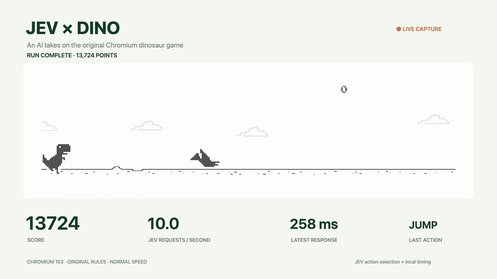

<div align="center">

# JEV × Dino

**10 decisions a second. Original Chromium physics. 13,724 points.**

A small experiment in connecting an asynchronous AI decision service to a real-time game—with a recorded result and inspectable evidence.

[](https://github.com/GiladR1979/jev-dino/actions/workflows/ci.yml)


[](LICENSE)

[**Watch / download the run ↗**](https://github.com/GiladR1979/jev-dino/releases/tag/v1.0.0) · [How it works](docs/ARCHITECTURE.md) · [Evidence & limitations](docs/RESULTS.md) · [Run locally](#run-locally)

[](https://github.com/GiladR1979/jev-dino/releases/tag/v1.0.0)

</div>

## The result

| Score      | Decision cadence   | Responses         | Response latency                   | Recording                   |
| :--------- | :----------------- | :---------------- | :--------------------------------- | :-------------------------- |
| **13,724** | **10.000 Hz** mean | **7,196 / 7,196** | **276 ms** median · **353 ms** p95 | **11:56** · 1080p60 + audio |

The run ended manually while the dinosaur was alive: **636 jumps, 83 ducks, no collision**. The original speed cap was reached. This is an achieved score in an endless game, not a maximum-score claim.

**What this demonstrates:** keeping a fast game responsive while slower model requests overlap; separating action selection from execution timing; preserving upstream behavior; and producing evidence a reviewer can inspect.

## Review in five minutes

1. Read [the architecture](docs/ARCHITECTURE.md) for the data flow and tradeoffs.
2. Inspect [`DecisionSession`](src/decision-session.ts): bounded concurrency, response identity checks, cancellation, and inert late responses.
3. Inspect [`launchX`](src/timing.ts): prediction on disposable copies using the original jump physics and collision checker.
4. Inspect [the server boundary](server/app.mjs) and [tests](tests/): origin checks, input validation, path containment, failed uploads, and credential isolation.
5. Compare [the recorded metrics](docs/results/run-1790258867455-summary.json) with the [video and evidence archive](https://github.com/GiladR1979/jev-dino/releases/tag/v1.0.0).

## What JEV actually does

Every 100 ms, the host sends JEV a small structured observation: the visible obstacle's type, position and width, the player's grounded state, and game speed. JEV returns one bounded choice: `jump`, `duck`, `run`, `inspect_more`, or `ask_user`.

A local controller schedules the chosen action and sends Space/Down keyboard events. Jump timing comes from a disposable copy of the original dinosaur and the original collision checker. The policy is deliberately simple; the engineering focus is the model-to-game boundary, timing, and evidence.

This is **structured-state action selection with local timing**, not screenshot-only control. The prompt explicitly describes the obstacle/action mapping. The recording labels the split as **“JEV action selection + local timing.”** No claim is made that a model is necessary to solve this game.

## Original game, separate host

The game code and assets are pinned to **Chromium 153.0.8010.53**. All **29 upstream files** are verified against a SHA-256 [source manifest](source-manifest.json), with a source URL for each file.

The host supplies browser integration shims, controls, telemetry, and recording. The upstream speed, acceleration, gravity, obstacle generation, collisions, and scoring are unchanged. There is no invincibility, score injection, time acceleration, or reduced difficulty.

The original source runs in a regular local Chrome page. This is **not the internal `chrome://dino` page**; browser integration, high-score persistence, and the surrounding presentation differ.

## Run locally

**Requirements:** Node.js 22.16+ and desktop Chrome. A TypeSafe/JEV API key is needed for AI play. FFmpeg is optional for MP4 export.

```sh
git clone https://github.com/GiladR1979/jev-dino.git
cd jev-dino
npm ci
cp .env.example .env
```

Set `TYPESAFE_API_KEY` in your local `.env`, or set `JEV_API_KEY_FILE` to a private key file (`chmod 600`). Then:

```sh
npm run check
npm start
```

Open **http://127.0.0.1:8794/**. Choose **Practice run** or **Record high-score run**. Keep the tab visible and focused; Chromium pauses when it loses focus. **Stop and save** ends the run and offers video/evidence downloads. Reload with **Start a fresh run** before the next attempt.

The server also saves recordings to `recordings/` and receipts/reports to `evidence/`. Both folders are ignored by Git. Capture includes the game canvas, telemetry, and game audio; it does not record the desktop or microphone. The recorder buffers data in browser memory, so stop and save periodically during long attempts.

```sh
# Optional: export a recorded WebM as H.264/AAC MP4, using FFmpeg on PATH
npm run export-video -- recordings/run-<timestamp>-score-<score>.webm
```

API requests are billable. The historical recording is estimated at **$0.18**, based on sampled token usage and the provider's rate at the time; this is not an exact invoice or a current price guarantee. [Cost methodology →](docs/RESULTS.md#cost)

## Development

```sh
npm test               # Offline tests; no key or paid requests
npm run typecheck      # Strict TypeScript for authored browser code
npm run verify-source  # Verify all 29 upstream files remain unchanged
npm run build          # Bundle the browser host and original game
npm run format         # Format authored code, leaving upstream bytes intact
npm run check          # All of the above checks, including format validation
```

The refactored host also passed a [one-minute Chrome validation](docs/VALIDATION.md): **859 points, 600 requests at 10 Hz**, with a recording verified from score zero and 21 offline tests passing.

GitHub Actions runs the checks on Node 22 and 24. Browser recording is Chrome-specific and is not exercised in headless CI. The 13,724-point video predates the maintainability refactor; its original controller bundle is included in the release evidence. It is evidence for that recorded run, not a benchmark of every later revision.

```text
src/
  chromium/            Original, unmodified Chromium implementation
  game-adapter.ts      Typed boundary around upstream internals + keyboard events
  decision-session.ts  Per-run requests, backpressure, and cancellation
  timing.ts            Original-physics jump forecasting
  recorder.ts          Canvas and game-audio capture
  presentation.ts      Recording canvas and telemetry layout
  controller.ts        Application orchestration
server/                Local HTTP boundary, JEV client, artifact storage
tests/                Offline behavior and security tests
docs/                 Architecture, results, and small review assets
```

## Attribution & license

Host/controller code: [MIT](LICENSE). Original game code, sprites and audio: **The Chromium Authors**, under [Chromium's BSD-style license](LICENSE.chromium). See [THIRD_PARTY_NOTICES.md](THIRD_PARTY_NOTICES.md).

An independent portfolio experiment; not affiliated with or endorsed by Google, Chromium, or TypeSafe AI.
