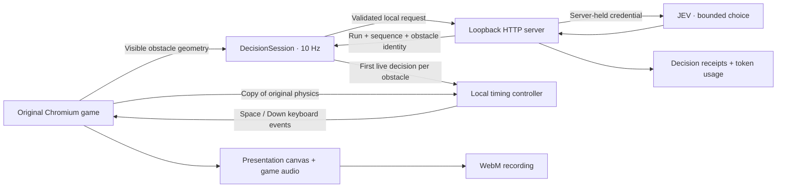
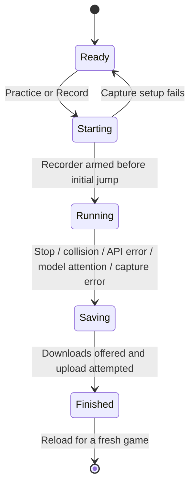

# Architecture

The game renders on its own animation loop. A separate 100 ms timer requests action choices; response latency therefore does not block rendering. A third concern—recording—observes the presentation canvas and game audio.

## Boundaries

| Module                      | Responsibility                                      | Explicit constraint                                                             |
| --------------------------- | --------------------------------------------------- | ------------------------------------------------------------------------------- |
| `game-adapter.ts`           | Typed access to the pinned Chromium implementation  | Private upstream APIs are isolated here; version changes need a new audit       |
| `decision-session.ts`       | Requests, identity checks, statistics, cancellation | At most 10 browser requests in flight; closing a run makes late responses inert |
| `timing.ts`                 | Predict a jump launch window                        | Simulates a copy; does not mutate the live player or obstacle                   |
| `controller.ts`             | One run per page, obstacle plans, lifecycle         | No locally chosen replacement action after a JEV failure                        |
| `recorder.ts`               | Canvas and game-audio capture                       | No microphone, desktop, or unrelated browser content                            |
| `server/app.mjs`            | HTTP and origin boundary                            | Binds to loopback; rejects foreign Host/Origin values                           |
| `server/jev-client.mjs`     | Fixed upstream endpoint and response validation     | Key never goes to the browser; no upstream error bodies reflected               |
| `server/artifact-store.mjs` | Receipts, reports, recordings                       | Safe names, exclusive writes, partial-upload cleanup, realpath containment      |

The server accepts injected client/storage dependencies. Tests exercise actual HTTP routes with an offline fake client; they do not contact JEV or need credentials. This keeps policy, transport, and storage independently reviewable without introducing a framework for a small local tool.

## Timing and action selection

JEV is given the obstacle/action mapping in the prompt. It selects the action ahead of the obstacle; the first valid response for a still-live obstacle is retained. Duplicates and responses for passed obstacles are ignored.

For a jump, the controller samples candidate launch positions. Each candidate runs the original `Trex.updateJump` and collision checker on disposable objects at a 60 Hz simulation step, then chooses a position inside the safe range. Rendering and the live game continue at their own frame rate. A fallback launch estimate exists when no sampled position is safe; it is a timing estimate for an already-selected jump, not an alternate action policy. Survival is not guaranteed.

A 100 ms interval is a target cadence, not a hard real-time guarantee. A busy browser, background throttling, rate limits, or ten outstanding requests can reduce effective throughput. The recorded mean was 10.000 Hz. The original game's speed rises to its configured cap; the game then continues indefinitely unless a collision or stop occurs.

## Lifecycle and failure behavior

Stopping first disables decisions and aborts pending browser requests. The adapter then permanently closes its input and visibility gates and calls Chromium's own stop method to cancel the game loop, including when stopped during the intro. Held keys are released after the gate closes so that a paused game's keyup handler cannot resume it. The gates are installed before Chromium binds its visibility callbacks and pass through unchanged while the run is active. Once terminated, late focus, visibility, keyboard, pointer, and touch events cannot reset or resume the game. The hidden game subtree becomes inert; page controls and download links remain usable. The final frame is held before recording stops, and a new game requires a reload. Download links are created before local upload so a disk or HTTP failure does not discard a successfully captured video. Evidence upload failure also leaves a browser download available.

Capture starts a zero-valued audio source before the encoder. This keeps audio timestamps active before the first game sound, preventing Chromium from discarding the opening video frames. Shutdown stops that source, capture tracks, and the recording audio context; regression tests cover completion and encoder startup failure.

The current server does **not retry** JEV requests automatically: an error ends the run visibly. The historical recorded prototype retried once. This deliberate change avoids hidden duplicate billable calls. Disconnects cancel upstream work where possible; a provider may still charge for work already accepted.

## Tradeoffs and limits

- The adapter reads private upstream fields. A pinned source version and hash checks make that dependency explicit; this is not a general browser-game API.
- Capture hooks `AudioContext.createBufferSource` within this isolated page to tap only game sounds. It is not intended as a reusable recorder for arbitrary sites.
- Recording chunks, dispatch times, and decision history remain in memory until saving. Very long sessions can exhaust browser memory; streaming persistence would be the next extension.
- Focus/visibility and hardware affect game frame rate and request cadence. This is a local desktop experiment, not a deployed multi-user service.
- Strict TypeScript covers authored browser code. Vendored Chromium is bundled unchanged; Node server modules are plain ESM with behavior tests.
- SHA-256 checks establish consistency with the checked-in manifest. Source URLs allow reviewers to independently compare against Chromium; they are not a signed attestation.
